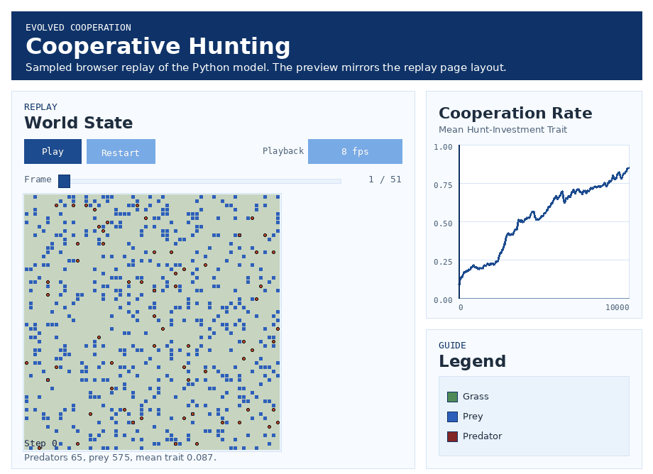
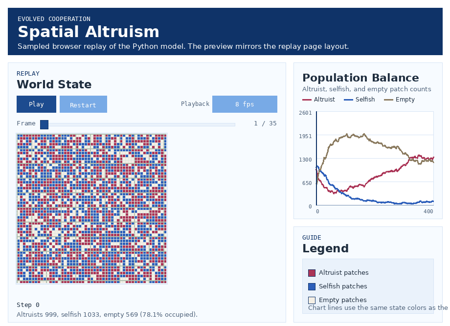

# EvolvedCooperation

A collection of agent-based models of how cooperation and altruism can evolve. The models use evolutionary
dynamics only (see [Cross-Repo Mapping](#cross-repo-mapping)); the one exception is the `kin_selection/learning`
follow-up, which tests learned helping.

## Main Achievements

As of 2026-11-22. Every result holds only for the model and settings it was run with; details, controls and
caveats are in each module's README or RESULTS file.

1. **A Python port of the Ethnocentrism model that passed its comparison with NetLogo, and evidence that
   ethnocentrism falls sharply when colour no longer tracks descent** (how often help is given hardly changes) ([`ecological_models/ethnocentrism/`](ecological_models/ethnocentrism/README.md),
   [RESULTS](ecological_models/ethnocentrism/RESULTS.md)). The port of the NetLogo model (Hammond & Axelrod 2006)
   showed no clear difference from NetLogo in any of 81 pre-registered experiment × metric comparisons. A numba
   version is 4-8× faster and replays every committed run bit for bit. Added lineage tracking shows that colour
   works as a kin cue: same-colour neighbours descend from the same immigrant in 90% of pairs, different-colour
   neighbours in 18%. Five pre-registered experiments followed:
   - making colour random at birth cut the ethnocentric share from 75.5% to 12.9%;
   - with the own-colour meeting share roughly matched, it was still 43 points lower (75.5% vs 32.4%), so the drop
     is not only fewer own-colour meetings;
   - randomly swapping agents' positions every tick, which removed the excess of related neighbours, cut
     cooperation from 75.6% to 11.0% of meetings under random colour;
   - with wide offspring dispersal, cooperation collapsed (75.6% to 4.2%) and inherited colour did not rescue it;
   - a Hamilton's-rule prediction made in advance from neutral relatedness got the direction of the late-run change
     in helper share right in all 8 cells far from the threshold (r·b/c = 0.5 or 2, relatedness 0.23-0.79), and in 6 of 8 near
     it (2 unclear, none reversed).

   The experiments narrow, but do not rule out, other differences between the arms. In a lattice model like this
   one, kin selection and spatial (network) reciprocity describe the same process.
2. **The five Nowak mechanisms side by side on one Moran engine**
   ([`moran_models/nowak_mechanisms/`](moran_models/nowak_mechanisms/README.md),
   [findings](moran_models/nowak_mechanisms/findings.md)). Kin selection, direct and indirect reciprocity, network
   reciprocity and group selection run on a shared fixed-population update rule. The investigation separated
   *origin* (spread from rare), *amplification* and *maintenance*: direct reciprocity maintains cooperation
   among reciprocators but only weakly invades from a single mutant, while spatial kin selection spread from rare
   in 5 of 5 seeds. Its comparative conclusion is that kin selection is the most biologically robust initiator
   tested, because its precondition (offspring stay near parents) is supplied by local reproduction, not
   because no other mechanism can start cooperation. In those runs a helper keeps part of its own benefit, so the
   spread is weak altruism (no net direct cost); under the broad definition used in this repo
   ([`kin_selection/README.md`](ecological_models/nowak_mechanisms/kin_selection/README.md), Definition and Goal)
   that is a warm-up, not kin selection itself. The first costly-helping result appears later, in the ladder (item 4).
3. **Ecological versions of all five mechanisms**
   ([`ecological_models/nowak_mechanisms/`](ecological_models/nowak_mechanisms/README.md)). The same mechanisms
   with sexual reproduction, life histories and energy instead of a Moran update. All five passed their
   proof-of-mechanism ablations (5 seeds, 500 steps), direct reciprocity only weakly. In four of them the
   load-bearing channel was reproductive assortment (offspring placement or mate choice), not the benefit routing
   in Nowak's conditions. Later controls found the ecological kin-selection evidence confounded: helper care there
   keeps the population alive, and no tested survival floor kept a no-helper population alive, so the controls
   cannot separate the trait's spread from care-dependent persistence
   ([`kin_selection/floor_control/`](ecological_models/nowak_mechanisms/kin_selection/floor_control/RESULTS.md)).
   Learned instead of inherited helping gave no detectable persistence benefit over a small constant care effort
   ([`kin_selection/learning/`](ecological_models/nowak_mechanisms/kin_selection/learning/README.md)).
4. **A stepwise rebuild from the Moran model towards ecology: the kin-selection ladder**
   ([`kin_selection/ladder/`](ecological_models/nowak_mechanisms/kin_selection/ladder/README.md),
   [RESULTS](ecological_models/nowak_mechanisms/kin_selection/ladder/RESULTS.md)). Adding one ingredient per
   pre-registered step:
   - costly help to neighbours spread only with local replacement (b/c 12: 20/20 seeds against 0/20 with global
     competitors), the ladder's one result for kin selection by viscosity with a real cost to the helper;
   - care for one's own young kept spreading through survival effects, ages, energy stores, birth costs, breeding
     and starvation cutoffs and a limited renewable resource (19-20/20 against 0/20 at every step). It spread just
     as well without local settlement. Under the broad definition used here (costly help to relatives by descent,
     offspring included; see `kin_selection/README.md`), this is kin selection through parental care, on an almost-full
     lattice, not kin selection among non-offspring relatives;
   - the rung with empty space produced no passing result (steps R5a-R8; R5b was skipped), and the line was closed
     at a hard stop agreed in advance. Under the replacement lottery the lattice stayed almost full whatever the
     energy rules; parent-driven births (R8) created vacancies, but care for own young then missed the endpoint.
     Every achieved step had a fixed population size. On 2026-11-24 step 5 was reopened as a smaller step, on the K1
     base without energy ([`ladder/STEP5_RESTART.md`](ecological_models/nowak_mechanisms/kin_selection/ladder/STEP5_RESTART.md));
     not met (care at b/c 6 still rising but 4/20 at the endpoint; a fixed-occupancy version 2/20), hard stop reached.
5. **Unconditional food sharing works against cooperative big-game hunting**
   ([`ecological_models/stag_hunt_sharing/`](ecological_models/stag_hunt_sharing/README.md)). In 1560 runs of a
   spatial stag hunt, sharing a catch with everyone nearby never raised the share of stag hunters and, at sharing
   fractions of 0.5 or more, ended stag hunting in every condition of the main sweep. Sharing radius and diminishing returns
   made little difference. Its prediction, made beforehand, was consistent with the later null result of the
   learned-hunter `deer_food_sharing` experiment in PredPreyGrass; this simpler model was not a test of that one.
6. **Four website-facing ecological models with browser replays**: spatial altruism, spatial Prisoner's Dilemma,
   cooperative hunting and retained benefit (see [Cross-Model Synthesis](#cross-model-synthesis)). Together they
   support a modest claim: cooperation persists only where the ecology returns enough of its benefit to cooperators
   or copies of the cooperative rule (*no cooperation without feedback*); without that, selfish behaviour usually
   wins. A pre-registered sweep of the retained-benefit model (all four predictions met) is the most direct test of
   this so far; there, in an exploratory look, where the rise starts lines up descriptively with whether a lone helper's own share
   covers its cost.
7. **An integrated hunter-gatherer band model**
   ([`behaviorally_anchored_model/`](behaviorally_anchored_model/README.md)) combining reciprocity bonds,
   reputation, norms, bands with territories and raids, households, child care, local foraging and social learning.
   It is built and runnable; it has no registered result yet.

**Across these lines** (a qualitative reading, subject to each model's controls), cooperation spread most often
where local reproduction itself created assortment (relatives as neighbours, partners or mates). Where the tests
broke that link (random colour, shuffled positions, wide dispersal, global replacement), helping usually declined. From the ethnocentrism experiments onward the work follows
one method: a pre-registered test with its own same-batch control, exact replays of earlier runs, and an
independent code review before the registered runs.

## Module Map

| Module | What it is | Status |
| --- | --- | --- |
| [`ecological_models/ethnocentrism/`](ecological_models/ethnocentrism/) | Hammond-Axelrod port with lineage tracking | closed 2026-11-22 |
| [`ecological_models/nowak_mechanisms/`](ecological_models/nowak_mechanisms/) | Ecological versions of the five Nowak mechanisms | all five built |
| [`ecological_models/nowak_mechanisms/kin_selection/`](ecological_models/nowak_mechanisms/kin_selection/) | Base ecological kin-selection model, with follow-up lines in `learning/`, `floor_control/`, `bonus_care/` and `ladder/` | follow-ups all closed or stopped (2026-11-18 to 11-20) |
| [`ecological_models/stag_hunt_sharing/`](ecological_models/stag_hunt_sharing/) | Spatial stag hunt with food sharing | done 2026-11-11 |
| [`ecological_models/spatial_altruism/`](ecological_models/spatial_altruism/) | Altruist/selfish lattice (NetLogo port) | website-backed |
| [`ecological_models/spatial_prisoners_dilemma/`](ecological_models/spatial_prisoners_dilemma/) | Spatial PD with movement, energy and inherited strategies | website-backed |
| [`ecological_models/cooperative_hunting/`](ecological_models/cooperative_hunting/) | Predator-prey-grass with a heritable hunt-investment trait | website-backed |
| [`ecological_models/retained_benefit/`](ecological_models/retained_benefit/) | Abstract lattice: how much benefit must return to cooperators | website-backed |
| [`moran_models/interaction_kernel/`](moran_models/interaction_kernel/) | Shared Moran engine with positive/negative routing kernels | engine |
| [`moran_models/nowak_mechanisms/`](moran_models/nowak_mechanisms/) | Five Nowak mechanisms on the Moran engine, plus direct-reciprocity scaffolds | done |
| [`threshold_models/kin_selection_siblings/`](threshold_models/kin_selection_siblings/) | Minimal threshold model: sibling alarm calls (after Primer), tested against Hamilton's rule `b·r > c` | Hamilton's rule reproduced 2026-11-26 |
| [`threshold_models/network_reciprocity_lattice/`](threshold_models/network_reciprocity_lattice/) | Minimal threshold model: one cooperator on a 10 × 10 lattice, death-birth updating, against `b/c > (N − 2)/(N/k − 2)` | direction held in all far cells; threshold location reproduced in a second registered test (finite-`N` value, not `b/c > k`), 2026-11-26 |
| [`behaviorally_anchored_model/`](behaviorally_anchored_model/) | Integrated hunter-gatherer band model | built, no registered result |

Third-party reference code (the NetLogo/Java Ethnocentrism sources and two cloned repositories) lives in
[`external/`](external/README.md), which is gitignored and skipped by pytest. Run all tests from the repo root
with `./.conda/bin/python -m pytest` (add `-n 8` for parallel workers). GitHub Actions runs the full suite on every
code push to main ([`.github/workflows/tests.yml`](.github/workflows/tests.yml)).

Each module's README holds its question, design and pre-registrations; its detailed outcomes go in a
`RESULTS.md` beside it (convention in [`AGENTS.md`](AGENTS.md#results-documentation); older modules keep results
inline in their README).

## Cross-Repo Mapping

`EvolvedCooperation` contains the canonical Python implementations for
website-facing cooperation models where cooperation changes through evolutionary
dynamics alone. Lifetime learning is intentionally out of scope here and is
handled in the companion repositories `LearnedCooperation` and
`EvolvedAndLearnedCooperation`.

The cooperation model repositories are separated by mechanism:

- `EvolvedCooperation`: evolutionary dynamics only; lifetime learning is out of scope.
- `LearnedCooperation`: lifetime learning only; evolutionary change is out of scope.
- `EvolvedAndLearnedCooperation`: coupled evolutionary and lifetime-learning dynamics.

The public website `https://humanbehaviorpatterns.org/` is built from the
sibling `human-cooperation-site` repo, so the matching website pages should
stay faithful to the Python implementations here.

For detailed cross-repo mapping and repository maintenance notes, see
`AGENTS.md`.

## Environments
This repo uses a project-local Conda environment stored at `.conda/` so it travels with the workspace and VS Code can auto-select it.

- Interpreter path: `/EvolvedCooperation/.conda/bin/python`
- VS Code setting: see `.vscode/settings.json` (we set `python.defaultInterpreterPath`, point VS Code at the local Conda executable, and use a repo-specific terminal profile instead of fixed-script launch entries)
- Matplotlib cache/config path for VS Code runs: `.vscode/.env` sets `MPLCONFIGDIR=.matplotlib`
- Ruff editor linting: install Ruff into the project environment with `./.conda/bin/python -m pip install ruff`
- Pylance note: `.vscode/settings.json` disables `reportMissingModuleSource` so compiled Matplotlib modules do not produce false-positive import warnings in editor diagnostics

### VS Code Run/Terminal behavior
The workspace is configured so VS Code uses the repo-local `.conda` deterministically:

1. `Terminal => New Terminal` opens `bash (.conda)`, which sources the normal shell startup and then activates `/EvolvedCooperation/.conda`.
2. `Run => Run Without Debugging` uses `.vscode/launch.json` plus `.vscode/run_active_python.py` to inspect the active editor file.
3. If the active file lives inside a Python package in the repo, the helper runs it with module semantics (`runpy.run_module(...)`), which matches `python -m ...` from the repo root and satisfies module-only guards.
4. If the active file is not inside a package, the helper falls back to normal script execution (`runpy.run_path(...)`).
5. The launch config still forces `${workspaceFolder}/.conda/bin/python`, so runs do not depend on whichever interpreter VS Code happened to remember previously.


## Cooperative Hunting Quick Start

The cooperative-hunting ecology model lives in
`ecological_models/cooperative_hunting/`.

- Main runtime: `ecological_models/cooperative_hunting/cooperative_hunting.py`
- Active parameters: `ecological_models/cooperative_hunting/config/cooperative_hunting_config.py`
- Detailed model notes and theory mapping:
  `ecological_models/cooperative_hunting/README.md`

Current mechanics in that model:

- predators carry a heritable continuous hunt investment trait `hunt_investment_trait in [0,1]`
- hunt contribution is `predator_energy * hunt_investment_trait`
- predator cooperation cost is paid directly as
  `predator_cooperation_cost_per_unit * hunt_investment_trait`
- the config file now uses descriptive canonical parameter names, while legacy
  short aliases remain accepted for backward compatibility
- optional plasticity has been removed from the active code path, so the stored
  trait is the value used for hunting and cost

Browser replay preview:

[](https://doesburg11.github.io/EvolvedCooperation/cooperative-hunting/)

Click the full-window animation preview to open the GitHub Pages replay viewer.

Project convention for this model:

- run from repo root with `./.conda/bin/python`

Minimal run example:
```bash
./.conda/bin/python -m ecological_models.cooperative_hunting.cooperative_hunting
```

## Cross-Model Synthesis

Taken together, the four current website-facing evolved-cooperation modules do
not support a strong claim that cooperation simply appears by default. They
support a more specific claim: cooperation persists only when the update rules
and ecology give cooperators some protection against immediate exploitation.

A useful near-universal formulation is: cooperation evolves when the benefits
created by cooperation flow back to cooperators, or to copies of the
cooperative rule, strongly enough to outweigh the private cost. In shorthand:
there is no cooperation without feedback.

The `ecological_models/retained_benefit/` module is the repo's most direct attempt to test
that claim in a deliberately abstract form.

Shared pattern across the current models:

1. There must be heritable variation in a cooperative trait or strategy.
2. Interactions must be local enough that cooperative benefits are not spread
   completely at random.
3. Some feedback mechanism must return enough of the cooperative benefit back
   toward cooperators.
4. Reproduction and turnover must allow successful local structures to spread.
5. The private cost of cooperation must stay low enough relative to the
   protected benefit.

The four modules implement that protection in different ways:

- `ecological_models/spatial_altruism/`: local clustering plus void competition and disturbance
  can support altruist-selfish coexistence
- `ecological_models/spatial_prisoners_dilemma/`: conditional reciprocity can outperform pure
  defection, but it still yields coexistence rather than universal cooperation
- `ecological_models/cooperative_hunting/`: costly cooperation can pay when coordinated hunting
  creates real synergy, but the current active baseline is a supported-start
  threshold-synergy case rather than a pure de novo emergence test
- `ecological_models/retained_benefit/`: in a pre-registered sweep (2026-11-22/23; 330 swept runs plus 10
  neutral-control runs), cooperation at b/c = 3 declined without retention and rose to about 0.8 with full
  retention, and at b/c = 8 it rose at every retained fraction; in an exploratory look, where the rise
  starts lines up descriptively with whether a lone helper's own share of its benefit covers its cost, and the design does not separate
  that self-return from benefit to relatives

Mapping the current models onto Nowak's five canonical mechanisms:

| Model | Primary Nowak mechanism | Secondary or adjacent | Not implemented |
| --- | --- | --- | --- |
| `ecological_models/spatial_altruism/` | Network reciprocity | Group-selection-adjacent spatial patch effects | Direct reciprocity, indirect reciprocity, explicit kin selection |
| `ecological_models/spatial_prisoners_dilemma/` | Direct reciprocity and network reciprocity | Local assortment through lattice position | Indirect reciprocity, explicit kin selection, explicit group reproduction |
| `ecological_models/cooperative_hunting/` | Not a clean single Nowak mechanism | Network reciprocity, byproduct mutualism, partner-like ecological feedback | Reputation-based indirect reciprocity, explicit kin selection |
| `ecological_models/retained_benefit/` | Generalized assortment and feedback | Kin-selection-like lineage routing, network reciprocity through local neighborhoods | Memory-based direct reciprocity, reputation-based indirect reciprocity |
| `moran_models/interaction_kernel/` | General engine, not a single mechanism | Kin-weighted routing, network-local routing, mixed help-harm | Mechanism-specific memory and reputation unless added as wrappers |

The five explicit Moran wrappers for Nowak's mechanisms live under `moran_models/nowak_mechanisms/`.
The additional `direct_reciprocity/scaffolds/` packages are direct-reciprocity
scaffold examples rather than pure well-mixed baselines.

For emergence from rarity, the mechanisms differ in fundamentality because they
create positive assortment in different ways. The useful ordering is:

1. **Kin selection** — genetic relatedness can favor helping from the start when
   enough benefit returns to copies of the cooperative rule.
2. **Network reciprocity** — spatial or graph clustering protects cooperative
   neighborhoods.
3. **Group selection** — group boundaries and between-group competition can
   favor cooperative groups despite within-group free riding.
4. **Indirect reciprocity** — reputation can scale cooperation among non-kin,
   but it requires observation, assessment, and memory.
5. **Direct reciprocity** — repeated interaction is strongest as amplification
   and maintenance; pure direct reciprocity has the hardest startup problem.

This is not a claim that kin selection is always the only or largest mechanism
in real systems. It is a claim about de novo emergence: kin, network, and group
mechanisms supply assortment earlier, while indirect and direct reciprocity need
more social-information or partner-history structure before they become reliable.

### 2026-05-08 Moran Emergence Baseline Check

The non-direct Nowak wrappers were tested in isolation with:

```bash
./.conda/bin/python -m moran_models.interaction_kernel.utils.compare_emergence_baselines
```

Stepwise impact:

1. The new utility compares indirect reciprocity, network reciprocity, group
   selection, and kin selection from the same low-start condition.
2. The run used initial mean cooperation trait about `0.119`,
   `B_plus_scale = [0.8, 1.0, 1.2]`, `C_scale = [0.10, 0.20, 0.30]`,
   eight seeds per cell, and 250 steps.
3. Emergence success means final mean trait at least `0.50` and a gain of at
   least `0.05` from the low start.
4. Indirect reciprocity succeeded in all 9 tested cells under the current
   reputation-weighted implementation.
5. Kin selection succeeded fully in 2 cells and partially in 3 more; network
   reciprocity and group selection each succeeded fully in 1 cell and partially
   in 2 more.
6. Network and group selection were strongly cost-thresholded, while kin
   selection retained more intermediate growth at moderate cost.

Artifacts:

- `moran_models/interaction_kernel/data/compare_emergence_baselines_20260508_134242_summary.csv`
- `moran_models/interaction_kernel/data/compare_emergence_baselines_20260508_134242_replicates.csv`
- `moran_models/interaction_kernel/data/compare_emergence_baselines_20260508_134242_summary.txt`

So the strongest repo-level conclusion at this stage is modest:

- the minimal conditions are not one magic parameter, but a bundle of
  assortment, feedback, inheritance, and a favorable cost-benefit ratio
- without such protection, selfish behavior usually wins
- with it, cooperation can persist, spread, or coexist, depending on the
  mechanism
- these models are mechanism-level demonstrations, not a universal law of the
  evolution of cooperation

## Models

### Behaviorally Anchored Model
- **Description:** Integrated population model that gives agents reputation
  sensitivity, norm enforcement, band identity, kin recognition, spouse bonds,
  households, child rearing, spatial awareness, direct-reciprocity bond
  fidelity, and social learning at the same time. The model is now oriented toward a more realistic
  hunter-gatherer starting point rather than a strict abstract Nowak-mechanism
  decomposition.
- **Website counterpart:** the historical framing page is
  <https://humanbehaviorpatterns.org/history-of-human-cooperation-and-competition>.
  That page defines the behaviorally anchored target capacities; this package is
  the canonical Python implementation for the small-scale family/foraging-band
  layer. The model intentionally does not implement later institutional layers
  such as agriculture, states, markets, law, money, writing, or bureaucracy.
  Territorial competition is therefore modeled as soft hunter-gatherer
  avoidance and scarcity-gated displacement, not as fixed property defense.
- **Files:**
	- `behaviorally_anchored_model/behaviorally_anchored_model.py`: core runtime, interaction routing, demographic update, and summary output
	- `behaviorally_anchored_model/config/behaviorally_anchored_config.py`: active runtime parameters and proof scenarios
	- `behaviorally_anchored_model/utils/live_viewer.py`: Pygame scatter viewer for spatial position, trait color, band color, reciprocity bonds, and summary metrics
	- `behaviorally_anchored_model/utils/proof_of_mechanism.py`: scenario proof utility for the integrated model
- **Usage:**
	- Edit parameters in `behaviorally_anchored_model/config/behaviorally_anchored_config.py`
	- Run:
		```bash
		./.conda/bin/python -m behaviorally_anchored_model.behaviorally_anchored_model
		```
	- Run live viewer:
		```bash
		./.conda/bin/python -m behaviorally_anchored_model.utils.live_viewer
		```
- **Current status and change log:** see
  [`behaviorally_anchored_model/README.md`](behaviorally_anchored_model/README.md).

### Spatial Altruism
- **Description:** Patch-based grid simulation of altruism vs selfishness, ported from NetLogo to Python/NumPy.
- **Browser replay preview:**

[](https://doesburg11.github.io/EvolvedCooperation/spatial-altruism/)

- **Features:**
	- Each cell can be empty (black), selfish (green), or altruist (pink)
	- Simulates benefit/cost of altruism, fitness, and generational updates
	- Fully vectorized NumPy implementation for fast simulation
	- Pygame UI for interactive exploration
	- Matplotlib plots for population dynamics
	- Grid search for parameter sweeps
	- Sampled browser replay and README GIF preview
- **Files:**
	- `ecological_models/spatial_altruism/altruism_model.py`: Core simulation logic
	- `ecological_models/spatial_altruism/altruism_pygame_ui.py`: Pygame-based interactive UI
	- `ecological_models/spatial_altruism/config/altruism_config.py`: Active runtime configuration
	- `ecological_models/spatial_altruism/config/altruism_website_demo_config.py`: Frozen website replay configuration
	- `ecological_models/spatial_altruism/images/`: Plotting scripts and generated image or Plotly outputs
	- `ecological_models/spatial_altruism/utils/export_github_pages_demo.py`: Website replay and preview GIF exporter
	- `ecological_models/spatial_altruism/utils/altruism_grid_search.py`: Parallel grid search for extended coexistence sweeps
	- `ecological_models/spatial_altruism/data/grid_search_results_extended.csv`: Results from the parallel grid search
- **Usage:**
	- Run core model:
		```bash
		# edit ecological_models/spatial_altruism/config/altruism_config.py first if needed
		./.conda/bin/python -m ecological_models.spatial_altruism.altruism_model
		```
	- Run Pygame UI:
		```bash
		./.conda/bin/python -m ecological_models.spatial_altruism.altruism_pygame_ui
		```
	- Run grid search:
		```bash
		./.conda/bin/python -m ecological_models.spatial_altruism.utils.altruism_grid_search
		```
	- Regenerate website replay bundle:
		```bash
		./.conda/bin/python -m ecological_models.spatial_altruism.utils.export_github_pages_demo
		```
- **Requirements:** `requirements.txt` (Python 3.11); the plotting scripts in `images/` also need
  `requirements-analysis.txt` (pandas, seaborn, plotly, and torch for surface fitting)

### Cooperative Hunting
- **Description:** Spatial predator-prey ecology where predators evolve a
  continuous cooperation trait that affects group hunting success, payoff
  sharing, and private cooperation cost.
- **Files:**
	- `ecological_models/cooperative_hunting/cooperative_hunting.py`: core simulation and runtime entry point
	- `ecological_models/cooperative_hunting/config/cooperative_hunting_config.py`: active runtime parameters
	- `ecological_models/cooperative_hunting/utils/matplot_plotting.py`: Matplotlib plotting helpers for baseline runs
	- `ecological_models/cooperative_hunting/utils/sweep_dual_parameter.py`: parameter sweep tooling
	- `ecological_models/cooperative_hunting/utils/tune_mutual_survival.py`: coexistence tuning utilities
	- `ecological_models/cooperative_hunting/README.md`: detailed interpretation and experiment guide
- **Usage:**
	- Edit parameters in `ecological_models/cooperative_hunting/config/cooperative_hunting_config.py`
	- Run:
		```bash
		./.conda/bin/python -m ecological_models.cooperative_hunting.cooperative_hunting
		```
- **Current status:**
	- uses raw inherited `hunt_investment_trait` directly for hunt effort and cooperation cost
	- supports equal-split or contribution-weighted prey sharing
	- includes headless analysis, pygame live rendering, and sweep/tuning helpers

### Spatial Prisoner's Dilemma
- **Description:** Spatial Prisoner's Dilemma ecology inspired by the
  FLAMEGPU implementation from `zeyus-research/FLAMEGPU2-Prisoners-Dilemma-ABM`.
  Agents interact locally, move when isolated, reproduce into neighboring empty
  cells, and inherit mutable strategies.
- **Relation to the other evolved-cooperation models:**
	- relative to `ecological_models/spatial_altruism/`, this model adds explicit agents, energy budgets, pairwise Prisoner's Dilemma play, movement, and conditional reciprocity; `ecological_models/spatial_altruism/` is the simpler lattice model of altruist versus selfish site competition
	- relative to `ecological_models/cooperative_hunting/`, this model is more game-theoretic and less ecological: it has no prey, grass, hunt coalitions, or continuous cooperation trait
	- taken together, the three models form a progression from local altruist-benefit selection (`ecological_models/spatial_altruism/`), to local reciprocity and inherited response rules (`ecological_models/spatial_prisoners_dilemma/`), to ecological synergy in predator group hunting (`ecological_models/cooperative_hunting/`)
- **Files:**
	- `ecological_models/spatial_prisoners_dilemma/spatial_prisoners_dilemma.py`: core runtime, logging, and summary output
	- `ecological_models/spatial_prisoners_dilemma/config/spatial_prisoners_dilemma_config.py`: active runtime parameters
	- `ecological_models/spatial_prisoners_dilemma/config/spatial_prisoners_dilemma_website_demo_config.py`: frozen website replay configuration
	- `ecological_models/spatial_prisoners_dilemma/utils/matplot_plotting.py`: Matplotlib plotting helpers
	- `ecological_models/spatial_prisoners_dilemma/utils/export_github_pages_demo.py`: website replay exporter
	- `ecological_models/spatial_prisoners_dilemma/README.md`: detailed mechanism and adaptation notes
- **Usage:**
	- Edit parameters in `ecological_models/spatial_prisoners_dilemma/config/spatial_prisoners_dilemma_config.py`
	- Run:
		```bash
		./.conda/bin/python -m ecological_models.spatial_prisoners_dilemma.spatial_prisoners_dilemma
		```
	- Regenerate website replay bundle:
		```bash
		./.conda/bin/python -m ecological_models.spatial_prisoners_dilemma.utils.export_github_pages_demo
		```
- **Current status:**
	- preserves the intended spatial play, movement, reproduction, mutation, and culling logic from the external model family
	- uses smaller CPU-friendly defaults instead of the original CUDA-scale population sizes
	- now exports both JSON run logs for analysis and a sampled website replay bundle from a frozen public config
	- now maps to the `human-cooperation-site` page at `/evolved-cooperation/spatial-prisoners-dilemma/`

### Retained Benefit
- **Description:** Abstract lattice model that tests a general cooperation
  condition: cooperation spreads when enough of the value it creates is routed
  back toward cooperators, or copies of the cooperative rule, to offset its
  private cost.
- **Relation to the other evolved-cooperation models:**
	- compared with `ecological_models/spatial_altruism/`, it replaces binary altruist-versus-selfish site types with a continuous cooperation trait and an explicit benefit-routing split
	- compared with `ecological_models/spatial_prisoners_dilemma/`, it removes repeated-game memory and discrete strategy families so the feedback structure is easier to isolate
	- compared with `ecological_models/cooperative_hunting/`, it removes predator-prey ecology and hunt-coalition mechanics so cooperative synergy is reduced to an abstract routing problem
	- it is therefore the most abstract website-facing module in the repo and the most direct test here of the claim that cooperation requires feedback
- **Files:**
	- `ecological_models/retained_benefit/retained_benefit_model.py`: core runtime, local benefit-routing rule, and summary output
	- `ecological_models/retained_benefit/retained_benefit_pygame_ui.py`: live lattice viewer with cooperation and lineage modes
	- `ecological_models/retained_benefit/config/retained_benefit_config.py`: active runtime parameters
	- `ecological_models/retained_benefit/config/retained_benefit_website_demo_config.py`: frozen website replay configuration
	- `ecological_models/retained_benefit/utils/matplot_plotting.py`: Matplotlib plotting helpers
	- `ecological_models/retained_benefit/utils/export_github_pages_demo.py`: website replay exporter
	- `ecological_models/retained_benefit/README.md`: detailed rationale and model explanation
- **Usage:**
	- Edit parameters in `ecological_models/retained_benefit/config/retained_benefit_config.py`
	- Run:
		```bash
		./.conda/bin/python -m ecological_models.retained_benefit.retained_benefit_model
		```
	- Run live viewer:
		```bash
		./.conda/bin/python -m ecological_models.retained_benefit.retained_benefit_pygame_ui
		```
	- Regenerate website replay bundle:
		```bash
		./.conda/bin/python -m ecological_models.retained_benefit.utils.export_github_pages_demo
		```
- **Current status:**
	- implements continuous cooperation traits plus inherited lineage labels on a spatial lattice
	- treats `retained_benefit_fraction` as the primary abstraction parameter
	- includes a Pygame viewer that can switch between cooperation intensity and lineage structure
	- exports a sampled website replay bundle from a frozen public config
	- writes JSON logs for headless analysis and can show a small Matplotlib summary figure

### Interaction Kernel
- **Description:** General non-website-backed interaction-kernel engine that
  separates trait-dependent production, positive and negative effect routing,
  fitness score formation, local selection, and inheritance.
- **Relation to the other evolved-cooperation models:**
	- relative to `ecological_models/retained_benefit/`, it is broader than retained benefit routing because it supports separate positive and negative kernels
	- relative to `ecological_models/spatial_altruism/`, it keeps the spatial local-selection structure but uses continuous traits and configurable routing kernels
	- relative to `ecological_models/spatial_prisoners_dilemma/`, it has no explicit pairwise game, memory, or strategy family labels unless those are added as mechanism-specific extensions
	- relative to `ecological_models/cooperative_hunting/`, it removes ecological entities and leaves a reusable produced-effect, routed-effect, and selection core
- **Files:**
	- `moran_models/interaction_kernel/interaction_kernel_model.py`: core interaction-kernel runtime and summary output
	- `moran_models/interaction_kernel/kernels.py`: positive and negative routing-kernel builders
	- `moran_models/interaction_kernel/selection.py`: local replacement and inheritance logic
	- `moran_models/interaction_kernel/metrics.py`: per-step summary metrics
	- `moran_models/interaction_kernel/config/interaction_kernel_config.py`: active runtime parameters
	- `moran_models/interaction_kernel/README.md`: detailed kernel description and rename note
- **Usage:**
	- Edit parameters in `moran_models/interaction_kernel/config/interaction_kernel_config.py`
	- Run:
		```bash
		./.conda/bin/python -m moran_models.interaction_kernel.interaction_kernel_model
		```
- **Current status:**
	- keeps the config file as the single source of truth for normal runs
	- uses theory-aligned `h`, `B_plus`, `B_minus`, `K_plus`, `K_minus`, `R_plus`, `R_minus`, `C`, and `W` notation
	- currently supports uniform and kin-weighted positive kernels plus none or uniform negative kernels
	- writes JSON logs for headless analysis
	- is present only in the Python repo for now and does not yet have a matching website page

## Ecological Models vs Moran Models: Feature Comparison

The table below separates the website-facing ecological models from the
Moran-process models used for mechanism-level comparisons.

| Feature | Ecological models (`ecological_models/`) | Moran models (`moran_models/`) |
| --- | --- | --- |
| Core question | What happens when cooperation is embedded in a concrete ecology? | Which cooperation mechanism works under a controlled Moran update rule? |
| Model scale | Scenario-specific systems with their own entities and state variables. | Shared abstract engine plus thin mechanism wrappers. |
| Main entities | Cells, agents, predators, prey, grass, lineages, empty sites, or local game players. | Lattice sites carrying a cooperation trait `h`, lineage or mechanism state, and fitness score `W`. |
| Cooperation representation | Binary strategy, conditional strategy, or continuous ecological investment depending on the model. | Usually one continuous help trait `h`; direct and indirect reciprocity add memory or reputation state. |
| Interaction mechanism | Local games, benefit routing, hunting synergy, movement, predation, disturbance, or ecological turnover. | Produced effects are routed through mechanism-specific kernels or hooks such as kin bias, memory, reputation, network locality, or group copying. |
| Selection and replacement | Model-specific birth, death, movement, predation, reproduction, disturbance, and population caps. | Moran-style local replacement: sites sample parents from neighborhoods using fitness-weighted selection, then inherit with mutation. |
| Role of space | Space is part of the ecology itself: it controls encounters, resources, empty sites, and local expansion. | Space mainly constrains who sends benefits to whom and who competes to replace whom. |
| Feedback pathway | Benefits return through ecological structure such as clusters, prey capture, retained benefit, or repeated local play. | Benefits return through explicit Nowak mechanisms: kin selection, direct reciprocity, indirect reciprocity, network reciprocity, or group selection. |
| Parameter style | Ecological parameters such as cost, benefit, prey energy, synergy, retained fraction, movement, and mortality. | Theory-aligned parameters such as `B_plus`, `C`, kernel mode, relatedness weights, memory decay, reputation bias, and group interval. |
| Best use | Demonstrating rich eco-evolutionary dynamics and generating replayable public examples. | Comparing mechanisms under matched assumptions and testing theory-level abstractions. |
| Outputs | JSON logs, plots, Pygame viewers, sampled browser replay bundles, and GitHub Pages demo routes. | JSON logs, summary statistics, comparison utilities, and Pygame live viewers. |
| Website status | Canonical Python implementations for the public replay-backed evolved-cooperation pages. | Python-side mechanism demos; some have matching public explanation pages, but no repo-level replay export bundle yet. |
| Example modules | `spatial_altruism`, `cooperative_hunting`, `spatial_prisoners_dilemma`, `retained_benefit`. | `interaction_kernel`, `kin_selection`, `direct_reciprocity`, `direct_reciprocity/scaffolds/spatial_clustering`, `direct_reciprocity/scaffolds/continuous_spatial_memory`, `indirect_reciprocity`, `network_reciprocity`, `group_selection`. |

The practical distinction is that ecological models ask whether cooperation can
survive inside a modeled environment, while Moran models ask how a named
cooperation mechanism behaves when the update rule is held mostly constant.

## Installation

Python 3.11. The project normally runs from its local Conda environment (`./.conda/bin/python`, see
[Environments](#environments)). To install the dependencies into another environment:

```bash
pip install -r requirements.txt            # models, viewers and tests (pinned)
pip install -r requirements-analysis.txt   # optional: spatial_altruism plotting/analysis scripts
```

The core versions are pinned because several tests replay committed runs bit for bit. For Pygame
visualization on Conda, you may also need:

```bash
conda install -y -c conda-forge gcc=14.2.0
```

## References
- Original NetLogo models from Uri Wilensky and the EACH unit (Evolution of Altruistic and Cooperative Habits)
- See `ecological_models/spatial_altruism/README.md` for more details
