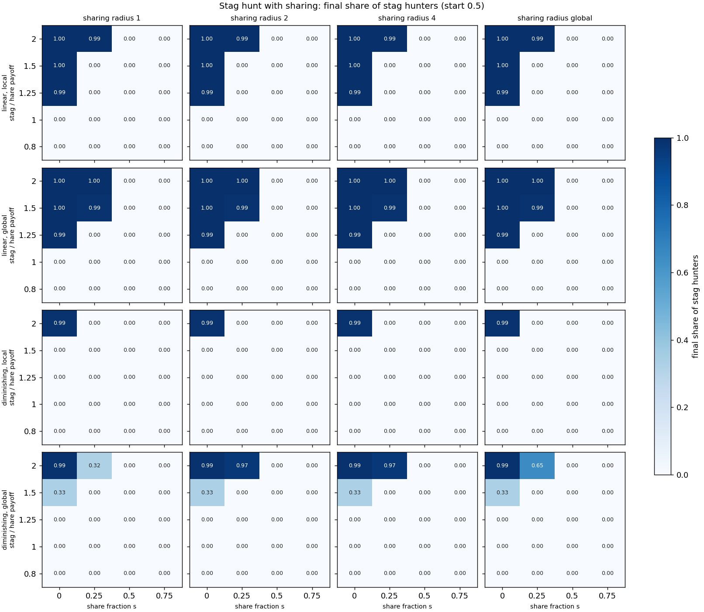

# Stag Hunt With Sharing

A small spatial model asking one question: **does sharing big game with
everyone nearby help cooperative big-game hunting evolve?** It was built on
2026-11-11 as a quick theoretical companion to PredPreyGrass's
`deer_food_sharing` experiment (learning hunters in continuous space, adult
deer shared with nearby hunters), to see beforehand where sharing could matter.

In human foragers, large, unpredictable packages of food are the ones shared
widely; sharing pools the risk of failed hunts and is one of the main proposed
reasons cooperative big-game hunting pays. Sharing with whoever is near
("tolerated scrounging") also feeds those who did not hunt.

## The model

One hunter per cell of a 64 x 64 torus, each with an inherited strategy, stag
or hare. Each generation:

1. **Hunting.** A hare hunter gets the hare payoff (1), always. A stag hunter
   with at least one stag-hunting partner among its 4 nearest neighbours
   catches a stag with probability q and gets the stag payoff V; alone, it gets
   nothing. V is set from the ratio (q x V) / hare payoff.
2. **Sharing.** Each caught stag gives a fraction s of V to the other hunters
   within the sharing radius (8 neighbours at radius 1, 24 at radius 2, 80 at
   radius 4, or everyone), split evenly, whatever they hunt. The catcher keeps
   the rest. Hares are never shared. Sharing moves food; it never creates any.
3. **Fitness** from food: linear (0.1 + food), or with diminishing returns
   (0.1 + 1 - exp(-food)), so that a failed hunt costs more than a lucky one
   gains (the case in which sharing works as insurance).
4. **Reproduction.** Every cell gets the offspring of a parent drawn by fitness
   from the cell and its 8 neighbours (local: neighbours tend to be kin), or
   from the whole population (global); the offspring switches strategy with
   probability 0.001.

The outcome is the share of stag hunters averaged over the last 1000 of 3000
generations, averaged over 3 seeds.

## Results (2026-11-11)

Sweep: s in {0, 0.25, 0.5, 0.75}, radius in {1, 2, 4, global}, stag-to-hare
ratio in {0.8, 1, 1.25, 1.5, 2}, linear or diminishing fitness, local or global
dispersal, starting from 5% or 50% stag hunters (q = 0.8; 1560 runs).




1. **Sharing never helped stag hunting; it hurt it.** In no condition did a
   positive s give more stag hunters than s = 0. With s >= 0.5, stag hunters
   died out in every condition. With s = 0.25 they survived only where stag
   hunting was already very profitable (ratio 2, or 1.5 with global dispersal).
2. **The sharing radius barely mattered.** Sharing with the 8 neighbours or
   with everyone gave nearly the same picture: the shares that reach
   hare-hunting neighbours are enough to tip the balance.
3. **Diminishing returns did not rescue it.** Insurance needs failed stag
   hunters to be fed by successful ones, but the same shares also feed hare
   hunters on top of their safe payoff. With diminishing returns, lumpy stag
   food is worth less anyway, and stag hunting survived only at ratio 2 without
   sharing (or with s = 0.25 under global dispersal).
4. **Riskier stags (one more sweep, q = 0.2 and 0.5, ratios 1-3, start 50%,
   local dispersal):** with diminishing returns stag hunters died out
   everywhere; with linear fitness s = 0.25 sometimes kept or slightly raised
   the stag share (ratio 3), and s >= 0.5 again ended it, except q = 0.5 at
   ratio 3 with s = 0.5.

**Reading.** In this model, unconditional sharing with everyone nearby is a
transfer from stag hunters to their neighbours, including free-riders, so it
works against stag hunting, as the free-rider argument predicts. It is the
classic result that tolerated scrounging alone does not favour hunting big
game; sharing has to be targeted (reciprocity, partner choice, punishment of
non-hunters) or bring other returns (status, mates) to help.

**What it suggests for `deer_food_sharing`** (s = 0.5 to every hunter within
128): sharing there is unlikely to raise partnering on adults. This is a
prediction from a much simpler, genetic model, not a test: PredPreyGrass's
hunters learn one shared policy, and their bystanders are other hunters who may
also try for adults.

**Limits.** Strategies are pure (stag or hare), not a probability; sharing is
unconditional; stag hunting needs only one partner among 4 neighbours, and two
neighbouring stag hunters each catch their own stag (no splitting of one
carcass); one grid size, mutation rate and fitness baseline; 3 seeds per
condition. With local dispersal the neighbours who receive a share are also
the ones competing to fill nearby cells, which works against any benefit to
kin (Codex review). Global dispersal removes that competition but also the kin
clusters; with it, s = 0.25 kept stag hunting at ratios 1.5 and 2 (start 50%)
and s >= 0.5 still ended it. A world with local kin clusters but wider
competition was not run.

## Targeted sharing (pre-registered 2026-11-11, before the sweep was run)

Two questions the first sweep left open:

1. **Does sharing help if it goes only to those who took part?** With
   `share_target = "stag"`, a caught stag's share goes only to the other stag
   hunters within the radius (whether they caught one or not); hare hunters
   get nothing. A catcher with no stag hunter near keeps its share. This is
   sharing as insurance among hunters, without feeding free-riders.
2. **Was the first result an artefact of local competition?** With
   `dispersal` set to a radius r, a cell's new hunter is the offspring of a
   parent drawn from the cells within distance r (r = 1 is the old "local").
   Wider r separates who receives shares (radius 1 or 4) from who competes
   for the cell, at the cost of weaker kin clusters.

Sweep (`SWEEP_TARGETED`): s in {0, 0.25, 0.5, 0.75}, target in {all, stag},
sharing radius in {1, 4}, ratio in {0.8, 1, 1.25, 1.5, 2}, linear or
diminishing fitness, dispersal radius in {1, 2, 4, global}, start 50% stag
hunters; q = 0.8, 3 seeds (520 conditions, 1560 runs).

**Measure.** A condition's stag share is the mean share of stag hunters over
the last 1000 of 3000 generations, averaged over seeds 1-3. Its effect is that
value minus the s = 0 value in the same world (same ratio, fitness shape and
dispersal; at s = 0 target and sharing radius play no part). Sharing *helps*
in a condition when the effect is above +0.05 and *hurts* when it is below
-0.05. Only conditions with s > 0 are classified (480: s 0.25, 0.5, 0.75 x
target x sharing radius 1 and 4 x 5 ratios x 2 fitness shapes x 4
dispersals). `utils/judge_targeted.py` computes this, after checking that every
condition has exactly seeds 1-3.

**Predictions, recorded before the run:**

- **P1.** Among the 30 conditions with target stag, diminishing fitness and
  dispersal radius 1 (any s > 0, sharing radius 1 or 4, any ratio), sharing
  helps in at least one (insurance: failed stag hunters are fed by successful
  ones, and no hare hunter is fed).
- **P2.** Among the 120 conditions with target stag and linear fitness (any
  s > 0, sharing radius, ratio and dispersal), sharing hurts in none (it only
  moves food among stag hunters).
- **P3.** Among the 240 conditions with target all (any s > 0, sharing radius,
  ratio, fitness shape and dispersal), sharing helps in none: wider
  competition doesn't rescue untargeted sharing.

If P1 fails, targeted sharing as insurance doesn't favour stag hunting in this
model either, and a targeted-sharing deer module would have no theoretical
support from it. These predictions are not changed after the run.

## Running

From the repository root (parameters in
[`config/stag_hunt_sharing_config.py`](./config/stag_hunt_sharing_config.py)):

```bash
./.conda/bin/python -m ecological_models.stag_hunt_sharing.stag_hunt_sharing
```

This runs the sweep in `SWEEP` with the seeds and workers in `RUN`, writes
[`data/sweep.csv`](./data/sweep.csv) and the two figures in `images/`
(about 5 minutes on 16 cores). The targeted-sharing sweep:

```bash
./.conda/bin/python -m ecological_models.stag_hunt_sharing.stag_hunt_sharing targeted
```

writes [`data/sweep_targeted.csv`](./data/sweep_targeted.csv) and
`images/targeted_radius1.png`, `images/targeted_radius4.png`; then

```bash
./.conda/bin/python -m ecological_models.stag_hunt_sharing.utils.judge_targeted
```

prints P1-P3 and writes `data/judge_targeted.txt`.

## Files

- [`stag_hunt_sharing.py`](./stag_hunt_sharing.py): the model, one run, the
  sweep.
- [`config/stag_hunt_sharing_config.py`](./config/stag_hunt_sharing_config.py):
  `MODEL` (one run's world), `SWEEP`, `RUN`.
- [`utils/plot_sweep.py`](./utils/plot_sweep.py): the heatmaps.
- [`tests/test_stag_hunt_sharing.py`](./tests/test_stag_hunt_sharing.py):
  partners, sharing as a pure transfer, who receives, fitness, reproduction,
  settings.
