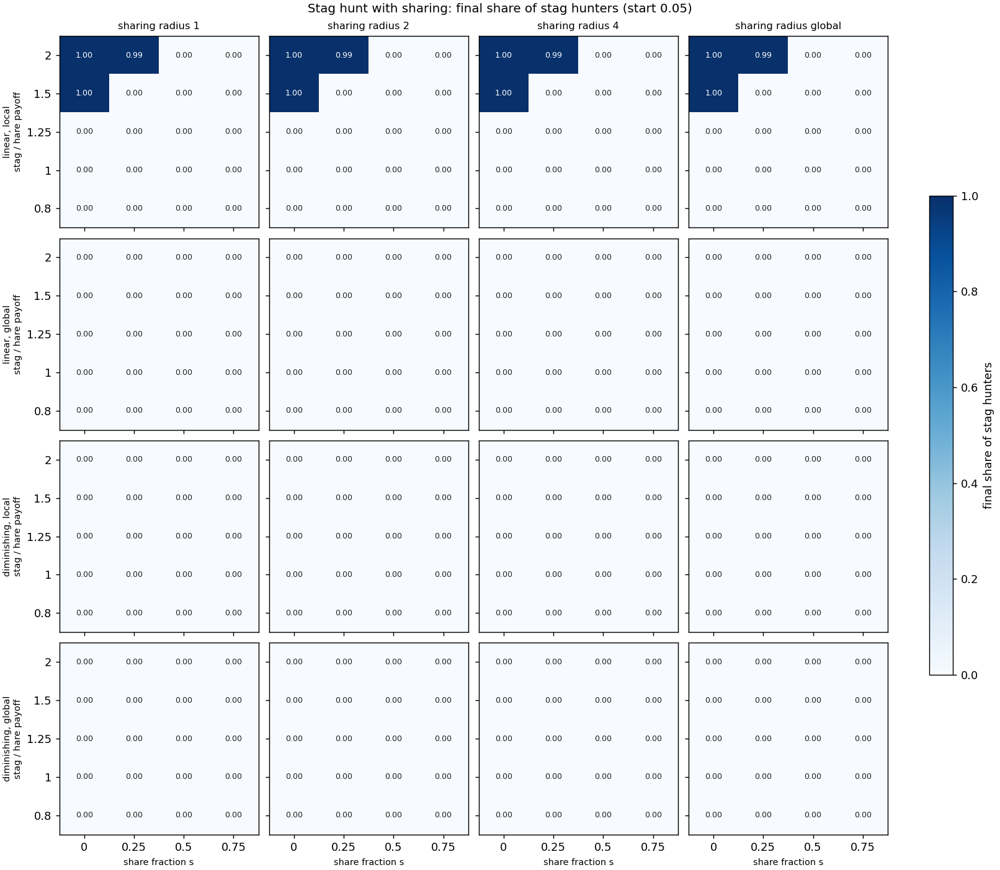
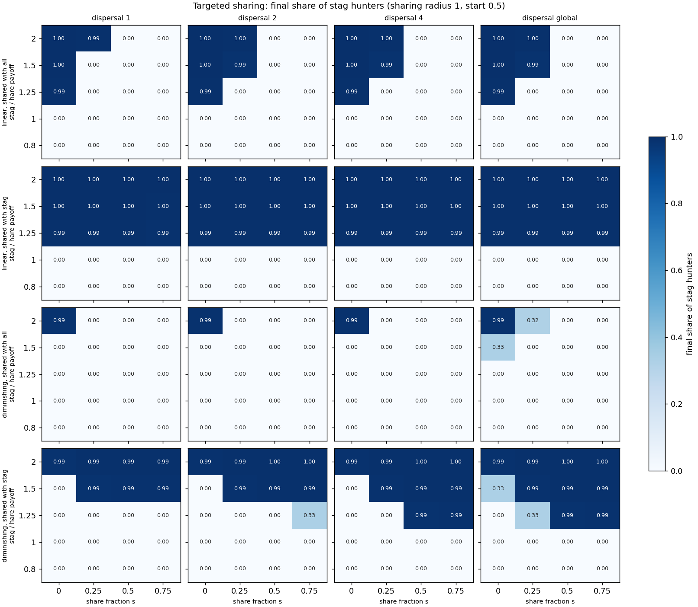
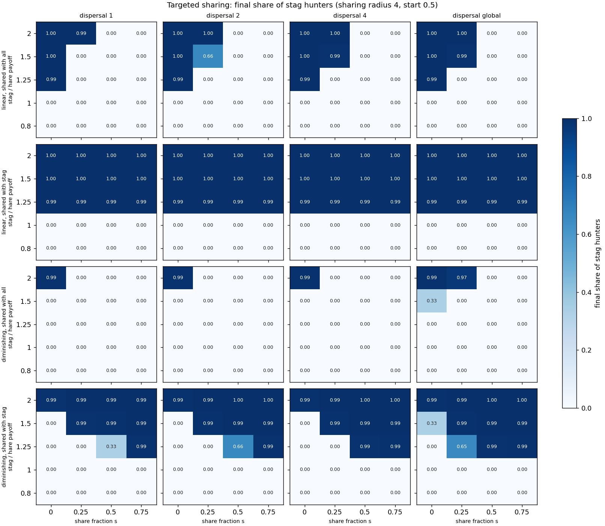

# Stag Hunt With Sharing

A small spatial model asking one question: **does sharing big game with
everyone nearby help cooperative big-game hunting evolve?** It was built on
2026-11-11 as a quick theoretical companion to PredPreyGrass's
`deer_food_sharing` experiment (learning hunters in continuous space, adult
deer shared with nearby hunters), to see beforehand where sharing could matter.

In human foragers, large, unpredictable packages of food are the ones shared
widely; sharing pools the risk of failed hunts and is one of the main proposed
reasons cooperative big-game hunting pays. Sharing with whoever is near
("tolerated scrounging") also feeds those who did not hunt.

## The model

One hunter per cell of a 64 x 64 torus, each with an inherited strategy, stag
or hare. Each generation:

1. **Hunting.** A hare hunter gets the hare payoff (1), always. A stag hunter
   with at least one stag-hunting partner among its 4 nearest neighbours
   catches a stag with probability q and gets the stag payoff V; alone, it gets
   nothing. V is set from the ratio (q x V) / hare payoff.
2. **Sharing.** Each caught stag gives a fraction s of V to the other hunters
   within the sharing radius (8 neighbours at radius 1, 24 at radius 2, 80 at
   radius 4, or everyone), split evenly, whatever they hunt. The catcher keeps
   the rest. Hares are never shared. Sharing moves food; it never creates any.
3. **Fitness** from food: linear (0.1 + food), or with diminishing returns
   (0.1 + 1 - exp(-food)), so that a failed hunt costs more than a lucky one
   gains (the case in which sharing works as insurance).
4. **Reproduction.** Every cell gets the offspring of a parent drawn by fitness
   from the cell and its 8 neighbours (local: neighbours tend to be kin), or
   from the whole population (global); the offspring switches strategy with
   probability 0.001.

The outcome is the share of stag hunters averaged over the last 1000 of 3000
generations, averaged over 3 seeds.

## Results (2026-11-11)

Sweep: s in {0, 0.25, 0.5, 0.75}, radius in {1, 2, 4, global}, stag-to-hare
ratio in {0.8, 1, 1.25, 1.5, 2}, linear or diminishing fitness, local or global
dispersal, starting from 5% or 50% stag hunters (q = 0.8; 1560 runs).




1. **Sharing never helped stag hunting; it hurt it.** In no condition did a
   positive s give more stag hunters than s = 0. With s >= 0.5, stag hunters
   died out in every condition. With s = 0.25 they survived only where stag
   hunting was already very profitable (ratio 2, or 1.5 with global dispersal).
2. **The sharing radius barely mattered.** Sharing with the 8 neighbours or
   with everyone gave nearly the same picture: the shares that reach
   hare-hunting neighbours are enough to tip the balance.
3. **Diminishing returns did not rescue it.** Insurance needs failed stag
   hunters to be fed by successful ones, but the same shares also feed hare
   hunters on top of their safe payoff. With diminishing returns, lumpy stag
   food is worth less anyway, and stag hunting survived only at ratio 2 without
   sharing (or with s = 0.25 under global dispersal).
4. **Riskier stags (one more sweep, q = 0.2 and 0.5, ratios 1-3, start 50%,
   local dispersal):** with diminishing returns stag hunters died out
   everywhere; with linear fitness s = 0.25 sometimes kept or slightly raised
   the stag share (ratio 3), and s >= 0.5 again ended it, except q = 0.5 at
   ratio 3 with s = 0.5.

**Reading.** In this model, unconditional sharing with everyone nearby is a
transfer from stag hunters to their neighbours, including free-riders, so it
works against stag hunting, as the free-rider argument predicts. It is the
classic result that tolerated scrounging alone does not favour hunting big
game; sharing has to be targeted (reciprocity, partner choice, punishment of
non-hunters) or bring other returns (status, mates) to help.

**What it suggests for `deer_food_sharing`** (s = 0.5 to every hunter within
128): sharing there is unlikely to raise partnering on adults. This is a
prediction from a much simpler, genetic model, not a test: PredPreyGrass's
hunters learn one shared policy, and their bystanders are other hunters who may
also try for adults.

**Limits.** Strategies are pure (stag or hare), not a probability; sharing is
unconditional; stag hunting needs only one partner among 4 neighbours, and two
neighbouring stag hunters each catch their own stag (no splitting of one
carcass); one grid size, mutation rate and fitness baseline; 3 seeds per
condition. With local dispersal the neighbours who receive a share are also
the ones competing to fill nearby cells, which works against any benefit to
kin (Codex review). Global dispersal removes that competition but also the kin
clusters; with it, s = 0.25 kept stag hunting at ratios 1.5 and 2 (start 50%)
and s >= 0.5 still ended it. A world with local kin clusters but wider
competition was not run.

## Targeted sharing (pre-registered 2026-11-11, before the sweep was run)

Two questions the first sweep left open:

1. **Does sharing help if it goes only to those who took part?** With
   `share_target = "stag"`, a caught stag's share goes only to the other stag
   hunters within the radius (whether they caught one or not); hare hunters
   get nothing. A catcher with no stag hunter near keeps its share. This is
   sharing as insurance among hunters, without feeding free-riders.
2. **Was the first result an artefact of local competition?** With
   `dispersal` set to a radius r, a cell's new hunter is the offspring of a
   parent drawn from the cells within distance r (r = 1 is the old "local").
   Wider r separates who receives shares (radius 1 or 4) from who competes
   for the cell, at the cost of weaker kin clusters.

Sweep (`SWEEP_TARGETED`): s in {0, 0.25, 0.5, 0.75}, target in {all, stag},
sharing radius in {1, 4}, ratio in {0.8, 1, 1.25, 1.5, 2}, linear or
diminishing fitness, dispersal radius in {1, 2, 4, global}, start 50% stag
hunters; q = 0.8, 3 seeds (520 conditions, 1560 runs).

**Measure.** A condition's stag share is the mean share of stag hunters over
the last 1000 of 3000 generations, averaged over seeds 1-3. Its effect is that
value minus the s = 0 value in the same world (same ratio, fitness shape and
dispersal; at s = 0 target and sharing radius play no part). Sharing *helps*
in a condition when the effect is above +0.05 and *hurts* when it is below
-0.05. Only conditions with s > 0 are classified (480: s 0.25, 0.5, 0.75 x
target x sharing radius 1 and 4 x 5 ratios x 2 fitness shapes x 4
dispersals). `utils/judge_targeted.py` computes this, after checking that every
condition has exactly seeds 1-3.

**Predictions, recorded before the run:**

- **P1.** Among the 30 conditions with target stag, diminishing fitness and
  dispersal radius 1 (any s > 0, sharing radius 1 or 4, any ratio), sharing
  helps in at least one (insurance: failed stag hunters are fed by successful
  ones, and no hare hunter is fed).
- **P2.** Among the 120 conditions with target stag and linear fitness (any
  s > 0, sharing radius, ratio and dispersal), sharing hurts in none (it only
  moves food among stag hunters).
- **P3.** Among the 240 conditions with target all (any s > 0, sharing radius,
  ratio, fitness shape and dispersal), sharing helps in none: wider
  competition doesn't rescue untargeted sharing.

If P1 fails, targeted sharing as insurance doesn't favour stag hunting in this
model either, and a targeted-sharing deer module would have no theoretical
support from it. These predictions are not changed after the run.

### Targeted sharing: results (2026-11-11)

`data/judge_targeted.txt` (`utils/judge_targeted.py`):

| Prediction | Conditions | Helps | Hurts | Verdict |
| --- | ---: | ---: | ---: | --- |
| P1: stag only, diminishing, dispersal 1: helps in at least one | 30 | 8 | 0 | met |
| P2: stag only, linear: hurts in none | 120 | 0 | 0 | met |
| P3: everyone: helps in none | 240 | 0 | 88 | met |





1. **Sharing among stag hunters rescued stag hunting under diminishing
   returns.** Without sharing, stag hunters died out at ratios 1.25 and 1.5
   (stag share 0.001 at every dispersal, except 0.33 at ratio 1.5 with global
   dispersal). With shares going only to other stag hunters, stag hunting
   took over (share about 0.99) in all 24 ratio-1.5 conditions and in 15 of
   24 at ratio 1.25. It helped in no condition at ratios 0.8 and 1 (stag
   hunters still died out) or 2 (they already won without sharing).
2. **Outcomes are all or nothing.** Every seed ended near 0 or near 1 (the
   intermediate means, 0.33 and 0.65, are 1 or 2 of 3 seeds taking over).
   At ratio 1.25, more sharing (s 0.5-0.75), a wider sharing radius (4) or
   wider dispersal made a takeover more likely; s = 0.25 at dispersal 1 never
   did.
3. **With linear fitness, sharing among stag hunters did nothing** (0 helps,
   0 hurts in 120 conditions): it only moves food among stag hunters, and
   without diminishing returns that doesn't change their total fitness.
4. **Sharing with everyone still never helped, at any dispersal radius**
   (0 of 240; it hurt in 88, mostly where stag hunting won without sharing:
   linear at ratios 1.25-2, diminishing at 1.5-2). So the first sweep's
   result wasn't a product of local competition alone.

**Reading.** In this model, sharing helps cooperative big-game hunting when it
is targeted at those who took part *and* food has diminishing returns, i.e.
when it works as insurance among hunters: a failed stag hunter fed by a
successful one survives a bad generation that would have cost it more than a
lucky one gains. Untargeted sharing feeds free-riders and never helps. The
effect is a switch between two stable states (almost no stag hunters, or
almost all), not a gradual shift.

**For PredPreyGrass.** `deer_food_sharing` tests the untargeted kind (adult
catches shared with every hunter within 128), which this model predicts
won't help (its RESULTS 1.5). A targeted analogue would share an adult
catch only with hunters who took part in hunting adults (for example, touched
or chased an adult recently) whether or not they caught it, and it could only
work as insurance if a hunter's energy has diminishing returns there (an
energy cap, or a fixed reproduction threshold, would give some). That is a
possible follow-up, not a plan.

**Limits** as above, plus: start 50% stag hunters only; q = 0.8 only; 3 seeds,
so in the bistable conditions a single seed moves a mean by 0.33.

## Riskier stags (pre-registered 2026-11-12, before the sweep was run)

PredPreyGrass's deer world (deer_stag_hunt's touch runs) has the starvation
barrier that makes insurance pay (about 60% of hunters starve), but adult
hunts there rarely succeed (about 1-2.5% of attempts). The targeted sweep
above used only q = 0.8. This sweep (`SWEEP_TARGETED_LOWQ`) asks whether
targeted sharing still helps when big game is risky: s in {0, 0.25, 0.5,
0.75}, target in {all, stag}, q in {0.2, 0.5}, ratio in {1, 1.5, 2, 3},
linear or diminishing fitness, dispersal radius 1 or global, sharing radius
1, start 50% stag hunters, 3 seeds (224 conditions, 672 runs). Measure and
thresholds as in "Targeted sharing", baselines matched within each q
(`utils/judge_targeted.py lowq`).

**Predictions, recorded before the run:**

- **R1.** Among the 24 conditions with target stag, diminishing fitness and
  q = 0.5, sharing helps in at least one.
- **R2.** Among the 24 conditions with target stag, diminishing fitness and
  q = 0.2, sharing helps in at least one (the riskier the hunt, the more
  insurance is worth, if stag hunters can find partners at all).
- **R3.** Among the 96 conditions with target all, sharing helps in none.

If R2 fails, targeted sharing gives no theoretical support at the deer
world's level of risk; if R1 and R2 both hold, a targeted-sharing deer module
is worth designing (a user decision, after deer_food_sharing's verdict).

### Riskier stags: results (2026-11-12)

`data/judge_targeted_lowq.txt`:

| Prediction | Conditions | Helps | Hurts | Verdict |
| --- | ---: | ---: | ---: | --- |
| R1: stag only, diminishing, q 0.5: helps in at least one | 24 | 13 | 0 | met |
| R2: stag only, diminishing, q 0.2: helps in at least one | 24 | 0 | 0 | not met |
| R3: everyone: helps in none | 96 | 1 | 18 | not met |

1. **At q = 0.5 targeted sharing still rescues stag hunting under diminishing
   returns, but only for richer stags**: ratio 1.5 to 3 (13 of 24 conditions,
   extinction to about 0.99), never at ratio 1.
2. **At q = 0.2 it never does under diminishing returns**: stag hunters died
   out with and without sharing. A stag catch is then mostly worth little
   (saturating fitness) and too rare to insure through 8 neighbours.
3. **Unexpectedly, at q = 0.2 with linear fitness and local dispersal,
   targeted sharing helped** (ratio 2: extinction to about 0.98-0.99 at every
   s; ratio 3: 0.84 to about 1.0). Not predicted; a plausible reading is that
   at q = 0.2 most stag hunters fail in any generation, and shares keep failed
   hunters inside stag clusters from losing their cells to hare hunters, but
   this was not tested.
4. **R3 failed narrowly**: untargeted sharing helped in 1 of 96 conditions
   (s = 0.25, q 0.2, ratio 3, linear, local dispersal: 0.84 to 0.96) and hurt
   in 18.

**For PredPreyGrass's deer world.** Per attempt, adult hunts there rarely
succeed (1-2.5%), but a hunter tries about 30 times in its life and catches
0.4-0.85 adults (touch_1-3 evaluations), so per lifetime its "q" is closer to
0.3-0.6. The obstacle is the payoff: a hunter's share of an adult brings about
1.43 energy (the smallest adults are the ones caught) against 1.27 for a young
deer, which a hunter catches about 26 times in its life. Adult hunting there
is far below a stag-to-hare ratio of 1, and in this model no kind of sharing
rescued stag hunting at ratio 1 or below. So the model predicts that targeted
sharing alone would not make adult hunting pay in the deer world as it is;
the adults' value would have to rise too (a change of world, not of sharing).

## Payoff threshold (pre-registered 2026-11-13, before the sweep was run)

The riskier-stags results put the deer world's obstacle in the payoff, not
the risk. Before any change to that world is considered, two questions:

**What do real foragers' payoffs look like?** A literature check
(2026-11-13, from abstracts and excerpts, not full texts) gives a contested
picture, not a clean number:

- Hadza men got a large carcass on about 1 hunter-day in 30 (Hawkes et al.),
  so big game is very risky per day; their revised mean hunting returns
  (about 830-1,050 kcal/h) roughly overlap palm starch (about 850-1,200
  kcal/h), and Hawkes and colleagues argue small game would pay a family
  more. They read big-game hunting as status competition ("show-off");
  Gurven and Hill dispute that, pointing to the amount, value and
  reliability of returns.
- A meta-analysis of 217 return rates (Lupo et al. 2021, as summarised)
  finds body size a poor predictor of on-encounter return; Broughton et al.
  (2011) find strong size-return relationships in Great Basin data.

These are rates of whole activities (acquisition, encounter and hourly
measures mixed), not this model's ratio (q times the stag payoff over the
hare payoff), so they give no empirical value or upper bound for it. As a
rough heuristic only: real big game does not obviously pay much more in
expectation than the alternatives, while the deer world's adults pay far
less than its young deer. Raising the adults' value towards parity would be
defensible; a world needing stags worth well above the alternatives would
rest on an assumption this evidence does not support.

**How rich must stags be for targeted sharing to work at the deer world's
lifetime q?** This sweep (`SWEEP_THRESHOLD`): target stag only, s in {0, 0.5,
0.75}, q in {0.3, 0.45, 0.6}, ratio in {1, 1.1, 1.2, 1.3, 1.4, 1.5, 1.75},
linear or diminishing fitness, dispersal radius 1 or global, sharing radius
1, start 50% stag hunters, 3 seeds (252 conditions, 756 runs). Measure and
threshold as in "Targeted sharing", baselines matched within each world
(`utils/judge_targeted.py threshold`). The threshold ratio for a (q, shape)
is the smallest swept ratio at which sharing helps in at least one condition
(s, dispersal) and at every larger swept ratio; the condition that helps may
differ from ratio to ratio.

**Predictions, recorded before the run:**

- **T1.** With diminishing fitness at ratio 1, sharing helps in none of the
  12 conditions (as in every earlier sweep).
- **T2.** With diminishing fitness at ratio 1.5, sharing helps in at least
  one condition at each q.
- **T3.** With diminishing fitness the threshold ratio lies in [1.1, 1.5] at
  every q.

**What follows.** Decided on the three diminishing thresholds together:

- all three are 1.2 or lower: one pre-registered deer run, with the adults'
  value raised as the single change, is worth proposing after Friday's
  verdicts;
- any is 1.3 or higher, or none in the sweep: targeted sharing would need
  stags richer than the heuristic above supports, and the sharing line
  closes. That would rule out only this insurance mechanism in this model,
  not insurance in general; other explanations of big-game hunting (such as
  the status reading above) would remain open, not established.

### Payoff threshold: results (2026-11-13)

`data/judge_threshold.txt`:

| Prediction | Conditions | Helps | Hurts | Verdict |
| --- | ---: | ---: | ---: | --- |
| T1: diminishing, ratio 1: helps in none | 12 | 0 | 0 | met |
| T2: diminishing, ratio 1.5: helps at every q | 12 | 4 | 0 | not met (not at q 0.3) |
| T3: diminishing: threshold in [1.1, 1.5] at every q | 3 | 2 | 1 | not met |

Threshold ratios with diminishing fitness: 1.75 at q 0.3, 1.4 at q 0.45, 1.2
at q 0.6. The riskier the stag, the richer it must be before targeted sharing
works; at the deer world's lifetime q (about 0.3-0.6) it needs stags worth
1.2 to 1.75 times the alternative in expectation. With linear fitness no
threshold was found (help appeared at some ratios, for example 1.3-1.5 at q
0.3-0.45 with local dispersal, but not at every larger one: where stag
hunting already wins without sharing there is nothing left to help).

**Decision, by the rule above:** two of the three thresholds are 1.3 or
higher, so the sharing line closes. Targeted sharing, as modelled here, needs
big game clearly richer than the alternatives, which the real-forager
heuristic does not support. This rules out only this insurance mechanism in
this model; it does not establish another explanation.

## Running

From the repository root (parameters in
[`config/stag_hunt_sharing_config.py`](./config/stag_hunt_sharing_config.py)):

```bash
./.conda/bin/python -m ecological_models.stag_hunt_sharing.stag_hunt_sharing
```

This runs the sweep in `SWEEP` with the seeds and workers in `RUN`, writes
[`data/sweep.csv`](./data/sweep.csv) and the two figures in `images/`
(about 5 minutes on 16 cores). The targeted-sharing sweep:

```bash
./.conda/bin/python -m ecological_models.stag_hunt_sharing.stag_hunt_sharing targeted
```

writes [`data/sweep_targeted.csv`](./data/sweep_targeted.csv) and
`images/targeted_radius1.png`, `images/targeted_radius4.png`; then

```bash
./.conda/bin/python -m ecological_models.stag_hunt_sharing.utils.judge_targeted
```

prints P1-P3 and writes `data/judge_targeted.txt`. The riskier-stags and
payoff-threshold sweeps run the same way with the arguments `targeted_lowq`
and `threshold` (judged with `lowq` and `threshold`, writing
`data/judge_targeted_lowq.txt` and `data/judge_threshold.txt`).

## Files

- [`stag_hunt_sharing.py`](./stag_hunt_sharing.py): the model, one run, the
  sweep.
- [`config/stag_hunt_sharing_config.py`](./config/stag_hunt_sharing_config.py):
  `MODEL` (one run's world), `SWEEP`, `RUN`.
- [`utils/plot_sweep.py`](./utils/plot_sweep.py): the heatmaps.
- [`tests/test_stag_hunt_sharing.py`](./tests/test_stag_hunt_sharing.py):
  partners, sharing as a pure transfer, who receives, fitness, reproduction,
  settings.
